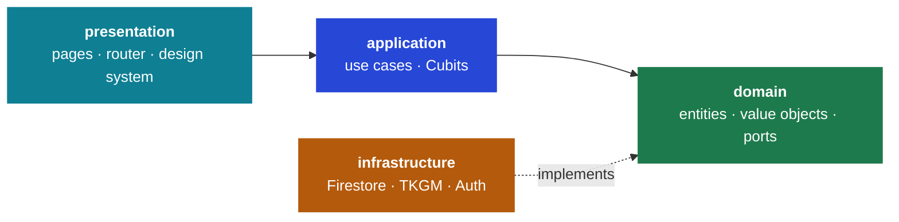

<a id="top"></a>

<div align="center">


# Parcel Atlas

### The land as the registry draws it — and as it really is.

A family's shared map of land parcels, for the web, Android, iOS, macOS and Windows.<br/>
Look a parcel up in the official Turkish land registry, draw its real boundary where the registry is wrong,<br/>
and record who owns which share — live on every family member's device.

[](https://parcel-info.web.app)

[](https://github.com/TrendHive/parcel-atlas/actions/workflows/ci.yml)
[](https://flutter.dev)
[](https://dart.dev)
[-FFCA28?style=flat-square&logo=firebase&logoColor=black)](https://firebase.google.com)
[](#-checking-your-work)
[](#-checking-your-work)

[Features](#-features) · [How it is built](#-how-it-is-built) · [Getting started](#-getting-started) · [Checking your work](#-checking-your-work) · [Security](#-security) · [Docs](#-documentation)

</div>

<br/>

## ✨ Features

<table>
<tr>
<td width="33%" valign="top">

#### 🗺️ Two layers, one map
The registry's parcels (cyan) and the family's real boundaries (orange) over aerial imagery. Switch either off to compare them.

</td>
<td width="33%" valign="top">

#### 🏛️ Official data, rationed
Parcels come from the land registry's own service. A tap inside a stored parcel never calls it; each parcel costs one lookup ever. Lookups run from the desktop and mobile apps — the registry refuses third-party websites.

</td>
<td width="33%" valign="top">

#### ✏️ Drawing made easy
Copy the registry outline and move only the wrong corners: drag numbered handles, tap "+" on an edge, place precisely with a crosshair, undo and redo. Corners snap onto neighbours, drawings cannot overlap, and a parcel splits in two or into equal pieces for the heirs.

</td>
</tr>
<tr>
<td valign="top">

#### 📐 Measured properly
Areas, perimeters and every side's length are computed on the WGS84 ellipsoid, shown live, saved with the drawing and compared with the deed area.

</td>
<td valign="top">

#### 👨‍👩‍👧‍👦 A family tree of owners
Owners hold deed-style shares (1/4). A share recorded on an ancestor passes down the tree, split equally among the children of each generation. The map can be coloured by any generation of the tree.

</td>
<td valign="top">

#### 📊 Holdings
For every person: each parcel, where it is, its area, the share that reaches them — and from which ancestor — with totals.

</td>
</tr>
<tr>
<td valign="top">

#### 🔄 Live on every device
One shared store, read live with an offline cache: a boundary drawn on one phone appears on every other at once.

</td>
<td valign="top">

#### 🕓 Every change signed
Each record says who created and last changed it, at the server's time, and a history lists every change by every member.

</td>
<td valign="top">

#### 🔐 Family only
Fixed accounts, no sign-up. The database's own rules admit only listed members; only the main account may delete.

</td>
</tr>
</table>

The interface is Turkish; the code and documentation are English. Everything runs on free tiers:
Firebase Spark (Hosting, Firestore, Auth), Esri World Imagery and OpenStreetMap, and the registry's
public parcel query service.

## 🧱 How it is built

Five layers in one package; the design system lives inside presentation. Arrows point the only way imports may go.



<sub>Underneath them all, **core** holds the base types, exceptions and their causes, validators and named constants. `main.dart` is the composition root — the only file that sees every layer.</sub>

| Idea | In practice |
|---|---|
| **Dependencies point inward** | A page never touches Firestore: it calls its Cubit, which calls a use case, which asks a port. `tool/check_structure.dart` fails the build on an import that goes the wrong way. |
| **Two sources, one truth** | `FirestoreStoreService` (the family's store) and `TkgmParcelService` (the official registry) are services; repositories combine them and are the single source of truth — store first, registry last. |
| **Registry data is reference data** | An official parcel changes only when the registry answers again. People, shares and notes live on the family's drawn boundaries. |
| **Failures are values** | Domain and application code never throw: every call that can fail returns `Either<BaseException, T>`, and the screen turns the exception's cause into Turkish words in one place. |
| **Rules are checked by machines** | Strict analyzer settings with zero issues allowed, a structure check, tests and a web build run on every push and pull request. |

<details>
<summary><b>The stack</b></summary>
<br/>

| Area | Choice |
|---|---|
| Framework | Flutter 3.50 · Dart 3.14 · `material_ui` |
| State | `flutter_bloc` — one Cubit per page, `sealed` states |
| Navigation | `go_router`, redirect driven by the session |
| Map | `flutter_map` 8 · `flutter_map_dragmarker` · Esri World Imagery · OpenStreetMap |
| Data | Cloud Firestore (offline cache) · Firebase Auth (e-mail/password, fixed accounts) |
| External API | TKGM parcel query (`megsiswebapi.v3.1`) over `dio` — see [`docs/tkgm-api.md`](docs/tkgm-api.md) |
| Geometry | WGS84 ellipsoid, local tangent plane, exact rational shares |
| DI | `get_it`, wired only in `main.dart` |
| Tests | `flutter_test` · `mocktail` fakes of every port |

</details>

The rules, with the reason for each, are in [`CLAUDE.md`](CLAUDE.md) and
[`architecture.md`](architecture.md); how they map to Flutter's official recommendations is in
[`docs/research.md`](docs/research.md).

## 🚀 Getting started

You need Flutter 3.50 and the Firebase CLI with access to the `parcel-info` project.

```bash
flutter pub get
git config core.hooksPath .githooks   # once per clone: the fast checks before every commit
flutter run -d chrome                 # hot reload works
```

<details>
<summary><b>Accounts</b> — there is no sign-up</summary>
<br/>

The main account adds family members from a terminal. The password is typed there, hidden, and goes
only to Firebase Auth:

```bash
dart run tool/add_member.dart <username> "<Display name>" --admin   # the main account
dart run tool/add_member.dart <username> "<Display name>"           # a family member
```

It creates the sign-in account, lists it in `firestore.rules`, deploys the rules and writes the member's
profile. Sign-in accounts are not parcel owners: owners are added in the app.

</details>

<details>
<summary><b>Where things are</b></summary>
<br/>

```
lib/
  core/            base types, exceptions + causes, validators, constants
  domain/          entities, value objects, read models, rules, ports — no Flutter
  application/     use cases, one Cubit per page
  infrastructure/  store and registry services, repositories, mappers, DTOs
  presentation/    pages, router, app shell
    core_ui/         app-agnostic base widgets
    domain_ui/       the app's widgets, theme, colours, l10n (Turkish template)
  main.dart        composition root
tool/              check_structure.dart, add_member.dart, import_parcels.dart
docs/              requirements, research, data model, registry API, status, roadmap
```

</details>

## ✅ Checking your work

Three commands must pass before a change is done, and CI runs them again with a format check and a web
build:

```bash
flutter analyze                       # zero issues — errors, warnings and infos
dart run tool/check_structure.dart    # layer imports, folders, one declaration per file, English-only code
flutter test
```

> [!IMPORTANT]
> **A bug fix ships the test that would have caught it**: a test named after the symptom that fails
> without the fix, a mechanical guard where one is possible, and an entry in
> [`docs/regressions.md`](docs/regressions.md).

## 📦 Shipping

One environment: production. Work goes feature branch → pull request → `dev` → release pull request →
`main`. Both `main` and `dev` are protected: they change only through pull requests whose **Gate** check
is green, and they cannot be force-pushed or deleted.

| On | CI does |
|---|---|
| Every pull request | Format, analyze, structure, tests, web build |
| `dev` | The same gate; `dev` deploys nowhere |
| `main` | The gate, then deploys to [parcel-info.web.app](https://parcel-info.web.app) |

## 🔒 Security

| Layer | What it does |
|---|---|
| **Member list** | Firestore's rules admit only the listed accounts; an account made outside the tool reads and writes nothing. |
| **Signed changes** | Every write carries the member and the server's time, and the rules reject a stamp that names someone else or another time. |
| **Read-only registry data** | Official parcels cannot be edited or deleted by anyone. |
| **Append-only history** | Activity lines cannot be changed or removed. |
| **Least privilege** | Only the main account may delete; everything not listed is denied. |

Nothing secret is committed: Firebase web configuration is public by design, passwords never leave the
member's own terminal, and the family's data lives only in the database. Report a vulnerability
privately to the repository owner rather than in a public issue.

## 📚 Documentation

| File | For |
|---|---|
| [`docs/status.md`](docs/status.md) | Where the work stands and what is next |
| [`docs/requirements.md`](docs/requirements.md) | Everything the owner asked for, and the decision for each |
| [`docs/research.md`](docs/research.md) | Flutter and Dart standards, and where the project deliberately differs |
| [`docs/data-model.md`](docs/data-model.md) | Firestore collections and security rules |
| [`docs/tkgm-api.md`](docs/tkgm-api.md) | The registry API and how to use it sparingly |
| [`docs/tkgm-parsel-sorgu.postman_collection.json`](docs/tkgm-parsel-sorgu.postman_collection.json) | Runnable Postman collection for the registry API — import and send |
| [`docs/regressions.md`](docs/regressions.md) | Bugs fixed, and the guard that keeps each fixed |
| [`docs/roadmap.md`](docs/roadmap.md) | What comes next |

<div align="right"><sub><a href="#top">↑ Back to top</a></sub></div>
